CNN (Convolutional Neural Network, свёрточная нейронная сеть) - нейронные сети для обработки данных с сетчатой структурой: фото, видео и т.д.
т.е. автоматическое выделелние признаков из визуальных данных
CNN делает это сама, причём иерархически:

- первые слои ловят простые вещи — края, линии, цветовые переходы;
- средние — формы, текстуры, части объектов (глаз, колесо);
- глубокие — целые объекты (лицо, машина, кот).

Из чего состоит

- Свёрточный слой (Conv) — применяет набор фильтров к входу, получая карты признаков (feature maps).
- Активация — обычно ReLU.
- Pooling (обычно Max Pooling) — уменьшает размерность, оставляя самое важное, даёт устойчивость к малым сдвигам. Полносвязные слои (FC) в конце — для классификации на основе извлечённых признаков.
- Batch Norm, Dropout — для стабильности и борьбы с переобучением.

Типичная архитектура: [Conv → ReLU → Pool] × N → Flatten → FC → Softmax.

Слой CNN:

```js
model.add(
  tf.layers.conv2d({
    // как много фильтров запустить
    filters: 32,
    // контроль размера фильтров. 3 показывает размер 3 на 3
    kernelSize: 3,
    // поскольку 3 на 3 фильтр не вместит всю фотографию, то это контролирует,
    // на сколько фильтр будет съезжать при фильтре фотографии
    strides: 1,
    // поскольку изображение по высоте и ширине может быть неровным, то при указании padding
    // мы замещаем значением пиксели, на которые не смог попасть фильтр
    // в случае same - это замещение на 0 по краям
    padding: "same",
    activation: "relu",
    inputShape: [TARGET_H, TARGET_W, 1],
  }),
);
```

В результате картинка

<br/>
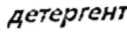
После выполнения CNN.ts мы получаем:

<br/>
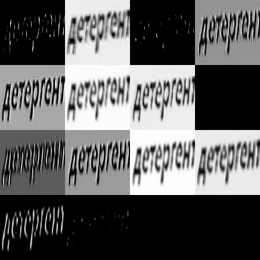
набор квадратов с каждым слоем, к которому был применён фильтр

- Каждый канал — это отдельный «взгляд» сети. Один фильтр хорошо реагирует на вертикальные штрихи, другой — на горизонтальные, третий — на края букв.
- Чем светлее пиксель — тем сильнее сработал фильтр в этом месте. Тёмный фон = «здесь ничего похожего не найдено».
- Каналы 0, 2, 13 — почти пустые. Это нормально: часть фильтров «не настроена» на этот паттерн, либо ReLU их погасил.
- Каналы 4–6, 8–11 — показывают контуры букв, причём по-разному: где-то жирнее, где-то тоньше, где-то видны только вертикальные элементы букв.
- Разные фоны (чёрный, белый, серый) — это не ошибка нормализации, а результат того, что каждый канал нормируется по своим min/max. У одного канала большая часть значений — фон, и он становится серым/чёрным, у другого — наоборот.

Это то, что касается конкретно свёрточного слоя

Та, часть, что касается слоя ReLU демонстрируется ниже:
активация lineral:

<br/>
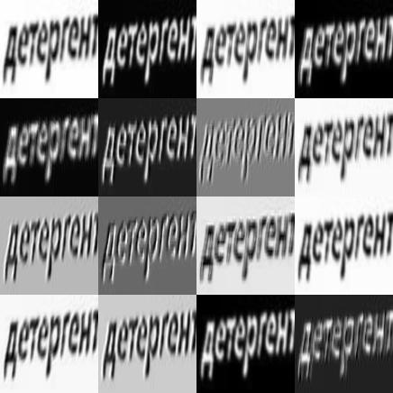
Заметно, что изменения в гриде происходят цветам, т.е. положительным или отрицательным значениям
Именно поэтому у каналов такие разные фоны: у одних среднее ближе к нулю, у других сдвинуто в плюс, у третьих в минус.

После ReLu мы наблюдаем:

<br/>
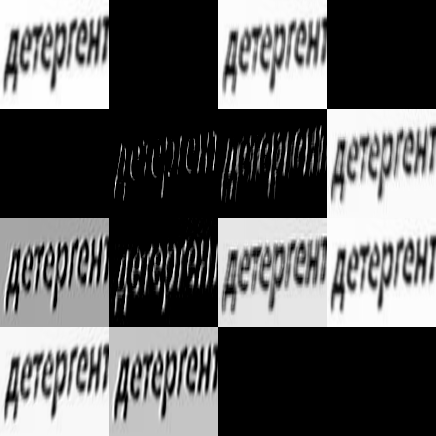
Все отрицательные значения стали нулями. Поэтому:

- Фон стал чёрным — там, где раньше были отрицательные активации, теперь 0.
- Остались только яркие пятна — те места, где свёртка «увидела» паттерн и выдала положительный отклик.
- Некоторые каналы (например, левый верхний, третий в первом ряду) выглядят как «шум из точек» — там ReLU обнулил почти всё, выжили единичные пиксели.

Если просто: формула ReLU(x) = max(0, x)

минусовые значения мы получаем после нормализации изображение из

```
  [[[255        , 255        , 255        ],
      [255        , 255        , 255        ],
      [255        , 255        , 255        ],
      ...,
      [254.4017944, 254.4017944, 254.4017944],
      [253.267868 , 253.267868 , 253.267868 ],
      [253        , 253        , 253        ]],

     [[255        , 255        , 255        ],
      [255        , 255        , 255        ],
      [255        , 255        , 255        ],
      ...,
      [254.4899292, 254.4899292, 254.4899292],
      [253.5230408, 253.5230408, 253.5230408],
      [253.2946472, 253.2946472, 253.2946472]],

     [[255        , 255        , 255        ],
      [255        , 255        , 255        ],
      [255        , 255        , 255        ],
      ...,
      [254.5780487, 254.5780487, 254.5780487],
      [253.7782288, 253.7782288, 253.7782288],
      [253.5892792, 253.5892792, 253.5892792]],

```

в

```
[[[[1 , 1        , 1        ],
       [1        , 1        , 1        ],
       [1        , 1        , 1        ],
       ...,
       [0.9976541, 0.9976541, 0.9976541],
       [0.9932073, 0.9932073, 0.9932073],
       [0.9921569, 0.9921569, 0.9921569]],

      [[1        , 1        , 1        ],
       [1        , 1        , 1        ],
       [1        , 1        , 1        ],
       ...,
       [0.9979997, 0.9979997, 0.9979997],
       [0.994208 , 0.994208 , 0.994208 ],
       [0.9933124, 0.9933124, 0.9933124]],

      [[1        , 1        , 1        ],
       [1        , 1        , 1        ],
       [1        , 1        , 1        ],
       ...,
       [0.9983453, 0.9983453, 0.9983453],
       [0.9952087, 0.9952087, 0.9952087],
       [0.9944677, 0.9944677, 0.9944677]],


```

Cам по себе тёмный пиксель ReLU не убивает. ReLU убивает отрицательный отклик фильтра, а отклик зависит от разницы между соседними пикселями, а не от их абсолютной яркости.

Пример: у тебя есть фильтр, который ищет вертикальный край (слева темнее, справа светлее):

```
-1  0  +1
-1  0  +1
-1  0  +1
```

Возьмём участок изображения, где всё очень тёмное (например, значения 20 и 25):

```
20  20  25
20  20  25
20  20  25
```

Отклик (отклик вычисляется на этапе conv2d): (-1·20) + (0·20) + (+1·25) = 5 — положительный. Фильтр сработал, несмотря на то что пиксели тёмные.

Теперь участок, где всё очень светлое (например, 200 и 205):

```
205  205  200
205  205  200
205  205  200
```

Отклик: (-1·205) + (0·205) + (+1·200) = -5 — отрицательный. ReLU его обнулит, хотя пиксели яркие.

ReLU реагирует не на «яркость», а на направление градиента. Тёмное изображение с контрастным краем даст положительный отклик. Светлое изображение с краем в «неправильную» сторону — отрицательный.

Работу conv2d демонстрирует скрипт conv2d-example

Сначала создается изображение 10 на 10 пикселей
Каждое из них задаётся с определенной яркостью:

```

  50  50  50  50 200 200  50  50  50  50
  50  50  50  50 200 200  50  50  50  50
  50  50  50  50 200 200  50  50  50  50
  50  50  50  50 200 200  50  50  50  50
  50  50  50  50 200 200  50  50  50  50
  50  50  50  50 200 200  50  50  50  50
  50  50  50  50 200 200  50  50  50  50
  50  50  50  50 200 200  50  50  50  50
  50  50  50  50 200 200  50  50  50  50
  50  50  50  50 200 200  50  50  50  50
```

Выглядит это так:
<br/>
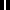

Ядром у нас является следующий паттерн:

```

  -1   0   1
  -1   0   1
  -1   0   1
```

Для каждой позиции таким образом высчитываем отклик:

```

=== Позиция (0,0): верхний левый угол ===
Окно в позиции (y=0, x=0):
    50 ×  -1    50 ×   0    50 ×   1
    50 ×  -1    50 ×   0    50 ×   1
    50 ×  -1    50 ×   0    50 ×   1
  Сумма: 0


=== Позиция (2,2): центр, где проходит край ===
Окно в позиции (y=2, x=2):
    50 ×  -1    50 ×   0   200 ×   1
    50 ×  -1    50 ×   0   200 ×   1
    50 ×  -1    50 ×   0   200 ×   1
  Сумма: 450
```

Получаем карту откликов вида:

```

     0     0   450   450  -450  -450     0     0
     0     0   450   450  -450  -450     0     0
     0     0   450   450  -450  -450     0     0
     0     0   450   450  -450  -450     0     0
     0     0   450   450  -450  -450     0     0
     0     0   450   450  -450  -450     0     0
     0     0   450   450  -450  -450     0     0
     0     0   450   450  -450  -450     0     0
```

Визуально выглядит так:
<br/>
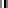

После ReLU выглядит так:
<br/>
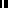

Т.е. по факты мы нашли соответствие паттерну:
слева темно, справа ярко

После работы conv формируется набор карт признаков изобржания
Для дальнейшего анализа необходимо использовать maxpooling для обобщения до более сложных признаков (круги, эллипсы, пересечения и т.д.)

Для этого размерность карт признаков сокращают с помощью maxpooling (отбор наибольших значений)

<br/>
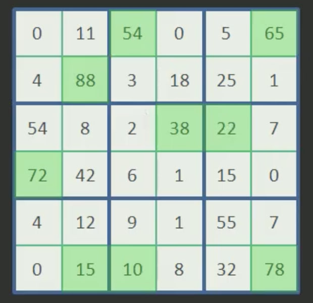

На выходе получаем сокращенную карту признаков, т.е. линейные размеры становятся в 2 раза меньше
<br/>


Если на следующем слое анализировать выделенные максимальные значения ядрами с теми же размерами, то это эквивалентно обработке максимального значения карты признаков
В результате мы получаем анализ данных на более крупном масштабе и благодаря этому нейроны следующего слоя способные выделять более общие признаки изображения

Для наглядности пути изображения можно посмотреть:
<br/>
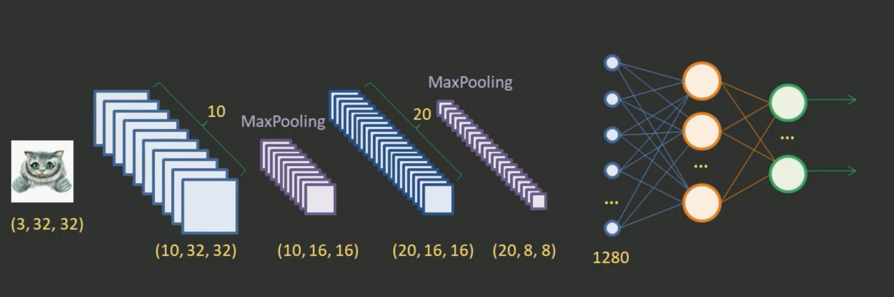

Изображения пропускается через 10 фильтров (ядер)
На выходе будет тензор [10, 32, 32]
Затем умееньшаем размер карты признаков в 2 раза с maxpooling
На выходе будет тензор [10, 16, 16]
Затем формируем новый набор карт признаков с 20ю фильтрами
На выходе будет тензор [20, 16, 16]
Затем умееньшаем размер карты признаков в 2 раза с maxpooling
На выходе будет тензор [20, 8, 8]
Продолжать эти итерации можно до тех пор, пока не дойдём до карты признаков 1px

В любой момент полученный тензор можно подать на вход обычной полносвязной нейронной сети

Напр. для тензора [20, 8, 8] -> вытягиваем в один вектор с помощью flatten (получится 1280 эл. = 20 _8_ 8)
Передаем в полносвязные сети (этап RNN). На выходе решаем задачу

Пример на моем изображении:

[ 1, 127, 127, 8 ]
<br/>
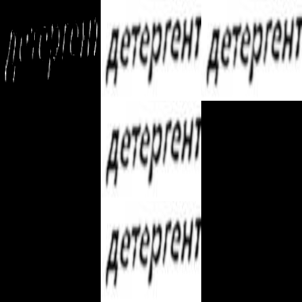

[ 1, 62, 62, 16 ]
<br/>
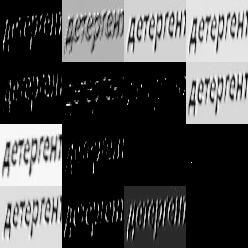

[ 1, 30, 30, 32 ]
<br/>
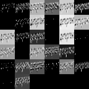

[ 1, 14, 14, 64 ]
<br/>
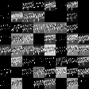

[ 1, 6, 6, 128 ]
<br/>
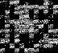

[ 1, 1, 1, 256 ]
<br/>
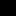
